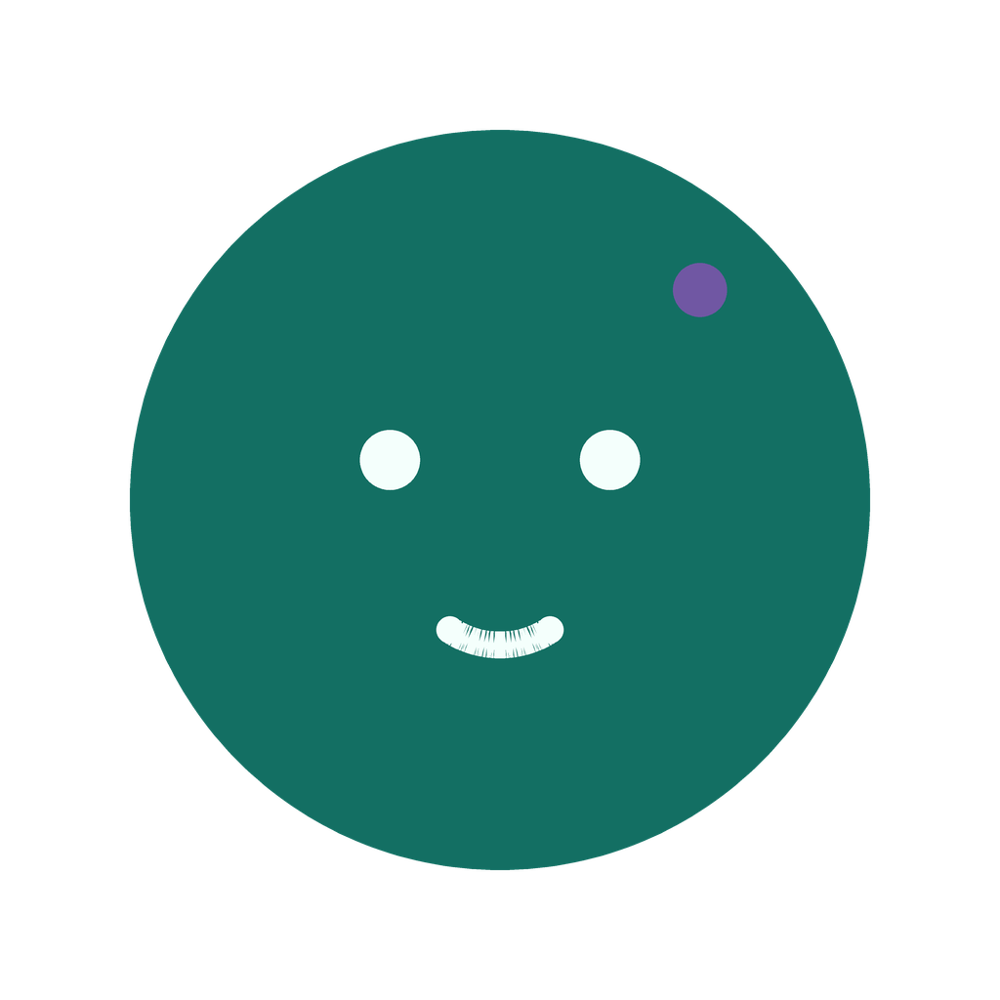

# Nanodot

<p align="center"></p>

<p align="center"><strong>Bring your own model. Work with Dot on your phone, desktop or browser.</strong></p>

<p align="center">
  <a href="LICENSE"></a>
  <a href="pyproject.toml"></a>
  <a href="docs/build.md"></a>
  <a href="#project-status"></a>
</p>

<p align="center"><a href="#quick-start">Quick start</a> · <a href="docs/index.md">Documentation</a> · <a href="docs/readme/README_zh.md">简体中文</a> · <a href="https://github.com/Mola-maker/nanodot/issues">Feedback</a> · <a href="#contributing">Contribute</a></p>

<details>
<summary>More languages</summary>

[繁體中文](https://github.com/Mola-maker/nanodot/blob/main/docs/readme/README_zh-TW.md) | [Español](https://github.com/Mola-maker/nanodot/blob/main/docs/readme/README_es.md) | [Français](https://github.com/Mola-maker/nanodot/blob/main/docs/readme/README_fr.md) | [Bahasa Indonesia](https://github.com/Mola-maker/nanodot/blob/main/docs/readme/README_id.md) | [日本語](https://github.com/Mola-maker/nanodot/blob/main/docs/readme/README_ja.md) | [한국어](https://github.com/Mola-maker/nanodot/blob/main/docs/readme/README_ko.md) | [Русский](https://github.com/Mola-maker/nanodot/blob/main/docs/readme/README_ru.md) | [Tiếng Việt](https://github.com/Mola-maker/nanodot/blob/main/docs/readme/README_vi.md)

</details>

Nanodot is an open-source personal AI agent with **Dot** as its default assistant. It brings together conversation, tools, memory and scheduled work, with Android and iOS app source, a desktop shell, a Web console and a Python runtime in one repository. It is derived from [nanoMuse](https://github.com/nano-muse/nanoMuse); the phone apps are based on [OpenMinis 1.13](https://github.com/OpenMinis/OpenMinis).

## What you can work on with Dot

| Use case | What the project provides | Learn more |
|---|---|---|
| Research and everyday work | Chat with your chosen model; use search, files and shell tools to turn a request into an output. | [Tools and configuration](docs/configuration.md) |
| Work that continues over time | Memory, goals, reminders and routines. Scheduled work requires a running agent. | [CLI](docs/cli.md) |
| Your own workflows | Extend the agent with skills and MCP servers. | [Skills and MCP](docs/configuration.md#skills) |
| Phone and computer tasks | Screen-operation implementations, with platform-specific permissions and limits. iOS cannot operate other apps. | [Phone](docs/android.md) · [Computer use](docs/gui.md) |
| Access from more than one device | A local Web console, plus optional device and conversation integrations through a relay. | [Web](docs/web.md) · [Devices](docs/device.md) |

These capabilities come from the inherited implementations. Nanodot packaging and device acceptance are tracked separately below; model support and platform permissions determine which tools are available.

## Meet Dot

Dot's five bundled faces work without downloading artwork. The theme follows your system; you can keep your own name, SOUL.md, avatar, animations and model choices.

<table>
  <tr>
    <td align="center"><br>Idle</td>
    <td align="center"><br>Working</td>
    <td align="center"><br>Waiting</td>
    <td align="center"><br>Happy</td>
    <td align="center"><br>Error</td>
  </tr>
</table>

## Quick start

### Try the Python runtime and Web console

You need **Python 3.11+** and a configured model provider. Install from this repository so you get Nanodot's source; the package and CLI retain the internal name `nanomuse`.

```sh
git clone https://github.com/Mola-maker/nanodot.git
cd nanodot
python3 -m venv .venv
. .venv/bin/activate
python -m pip install -e .
nanomuse config init
```

On Windows, use `py -m venv .venv` and activate with `.venv\Scripts\Activate.ps1` in PowerShell. Edit the `[llm]` section of `config/config.toml` with your provider, model, endpoint and API-key environment variable. The [example configuration](config/config.example.toml) and [provider guide](docs/own-key.md) explain the choices. Model API usage may incur provider charges; the default setup does not supply a key or allowance.

```sh
nanomuse doctor       # Check your configuration and available tools.
nanomuse chat         # Start a conversation in the terminal.
# Or start the local Web console:
nanomuse serve
```

Open the local URL printed by `serve`, including its authentication details. It listens locally by default. See [Web setup](docs/web.md) before enabling remote access.

Try a small first task: **“Create a checklist for my next trip and save it as trip.md.”** Review tool approval requests as they appear. Browser automation and desktop screen operation need [additional setup](docs/every-device.md).

### Build the Android app

The Android target is **Android 8+ on ARM64**. Follow the [build guide](docs/build.md) to prepare JDK 21, the Android SDK/NDK, Go and native dependencies, then run:

```sh
bash scripts/build-nanodot-apk.sh debug
```

The wrapper writes the APK and verification records under `dist/nanodot/`. Debug packages use a debug signature; a release build requires a dedicated signing key. It does not publish a release. Configure your model under Settings → Models, then start with a text conversation.

## Project status

**Nanodot is a source preview. There is currently no formal Nanodot GitHub Release.** The inherited version is **1.0.1**; Android versionCode is **44**.

| Area | Current boundary |
|---|---|
| Nanodot identity | Shared branding, offline Dot faces and system-theme defaults are in the source. |
| Android | Build from source. Real-device installation, native operation and signed-upgrade acceptance need their own checks. |
| Desktop and iOS | Source and build configurations are present. Native packaging, signing and device acceptance require the corresponding platforms. |
| Floating Dot and care interaction | Work beyond the initial branding scope; do not assume a downloaded branding build includes it. |
| Downloads and updates | Check [Nanodot releases](https://github.com/Mola-maker/nanodot/releases) for future published packages. Automatic updates are disabled. |

Continuous voice defaults to off. Enabling accessibility or other permissions is an explicit device action. Upstream nanoMuse APKs, desktop installers and TestFlight builds are separate products.

## Models, data and permissions

- **Use your own model provider.** The inherited runtime and clients support provider configuration; available capabilities depend on the selected model. See [own-key setup](docs/own-key.md).
- **Review actions.** The Python runtime's [Sentinel](docs/sentinel.md) handles tool approvals. Phone and desktop operation also require the relevant platform permissions.
- **Understand data flow.** Local execution still sends prompts and selected content to the model provider when inference runs. Read [privacy](docs/privacy.md) and [data controls](docs/sync.md).
- **Optional upstream services keep their identity.** nanoMuse Cloud is the upstream service. Nanodot does not operate it or promise its availability or free allowance; its provider controls accounts and policies.

Android uses `io.github.nanodot.app` and the external `nanodot://` scheme. Existing internal packages, `minis://` routes and sandbox paths remain stable. Nanodot has separate private app storage: moving data from nanoMuse requires an explicit supported export/import.

## Documentation

[Start here](docs/index.md) · [Build](docs/build.md) · [Configuration](docs/configuration.md) · [Architecture](docs/architecture.md) · [Troubleshooting](docs/troubleshooting.md) · [Changelog](CHANGELOG.md)

Platform and runtime pages include inherited nanoMuse implementation guidance. Read them alongside [Nanodot's build boundaries](docs/build.md#other-platforms-and-acceptance).

## Contributing

Both users and developers can help:

- **Try a workflow** and [report the result](https://github.com/Mola-maker/nanodot/issues/new/choose), including your source revision, platform, model and reproducible steps. Keep credentials and private content out of reports.
- **Improve onboarding** with clearer docs, translations or platform build notes. Read [CONTRIBUTING.md](CONTRIBUTING.md) and [AGENTS.md](AGENTS.md); commits require DCO sign-off.
- **Share a concrete example** with a link to this repository. If Nanodot is useful to you, a GitHub star helps other people discover it.

Use [Nanodot issues](https://github.com/Mola-maker/nanodot/issues) for this project. The licence is [GPL-3.0-or-later](LICENSE); upstream attribution is retained in [NOTICE](NOTICE) and [THIRD_PARTY_NOTICES.md](THIRD_PARTY_NOTICES.md). Nanodot is independent of Meta and its Muse trademark.

## Upstream history and credits

The following news, paper citation, maintainer and contributor cards, and acknowledgements are inherited nanoMuse records. Their original dates, names and links identify the upstream project, not Nanodot releases or maintainers.

<details>
<summary>nanoMuse</summary>

## 🗞️ News

- `2026-10-09` 🚀 Version [1.0.0 Keel](https://github.com/nano-muse/nanoMuse/releases/tag/v1.0.0) is out, for the phone, the desktop and the browser; it installs over the version before and keeps your data, and its release notes list every change.
- `2026-10-08` 🤗 Our paper is on [Hugging Face Daily Papers](https://huggingface.co/papers/2610.08699), ranked third on the list for October 8; questions and comments are welcome on the paper page.
- `2026-10-07` 📄 Our paper is available on [arXiv](https://arxiv.org/abs/2610.08699): *nanoMuse: An Open-Source Personal Agent for Every Device You Own*, by Guangyi Liu, Yong Liu and Jiangning Zhang (Zhejiang University); the citation is at the end of this page.
- `2026-09-25` 🎉 nanoMuse is released on GitHub under GPL-3.0-or-later: an Android app built on OpenMinis 1.13; the relay, the desktop app and the iPhone app came in the days after.

Every version: [releases](https://github.com/nano-muse/nanoMuse/releases).

## Maintainers

<table>
  <tr>
    <td align="center"><a href="https://github.com/lgy0404"><br><strong>Guangyi Liu</strong></a><br><a href="mailto:guangyiliu@zju.edu.cn"></a></td>
  </tr>
</table>

## Community Contributors

Everyone whose change has landed on `main`, from GitHub's contributors list.

<!-- contributors:start -->
<p>
<a href="https://github.com/wsvn53"></a>
<a href="https://github.com/aliabbas6622"></a>
<a href="https://github.com/PovedaAqui"></a>
<a href="https://github.com/jiangkaiqi2005"></a>
</p>
<!-- contributors:end -->

## ⭐️ Citation

If you find nanoMuse useful, please cite the paper.

```bibtex
@misc{liu2026nanomuseopensourcepersonalagent,
      title={nanoMuse: An Open-Source Personal Agent for Every Device You Own}, 
      author={Guangyi Liu and Yong Liu and Jiangning Zhang},
      year={2026},
      eprint={2610.08699},
      archivePrefix={arXiv},
      primaryClass={cs.AI},
      url={https://arxiv.org/abs/2610.08699}, 
}
```

## Acknowledgements

nanoMuse stands on other people's work; [THIRD_PARTY_NOTICES.md](THIRD_PARTY_NOTICES.md) has the terms.

- [OpenMinis](https://github.com/OpenMinis/OpenMinis): the on-device agent the phone app is built on, with [proot](https://github.com/nano-muse/proot) and [Alpine Linux](https://alpinelinux.org/) for the sandbox.
- [DeepSeek Harness](https://github.com/deepseek-ai/deepseek-harness): the agent harness the desktop app is a plugin of.
- [UI-TARS-desktop](https://github.com/bytedance/UI-TARS-desktop) (ByteDance): the desktop hands' operator is a port of theirs, and the stage's markers follow their ScreenMarker.
- [MobileGym](https://github.com/Purewhiter/mobilegym), [MemGUI-Bench](https://github.com/lgy0404/MemGUI-Bench), [PhoneHarness](https://github.com/PhoneHarness/PhoneHarness), [CopilotKit/OpenMuse](https://github.com/CopilotKit/OpenMuse), [Open-AutoGLM](https://github.com/zai-org/Open-AutoGLM), [ClawGUI](https://github.com/ZJU-REAL/ClawGUI): the phone operator, the traces and the product ideas.

</details>

<p align="center"></p>
