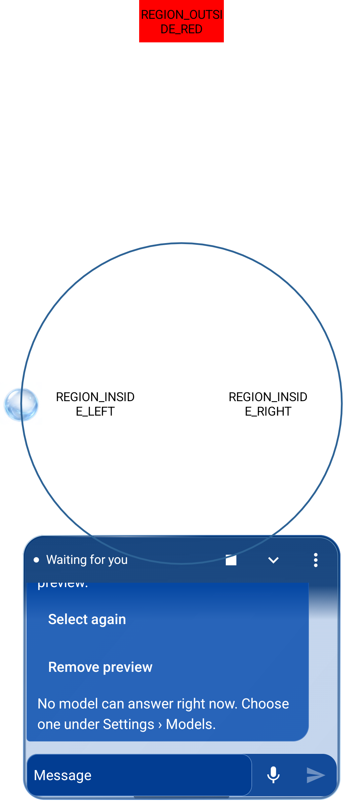
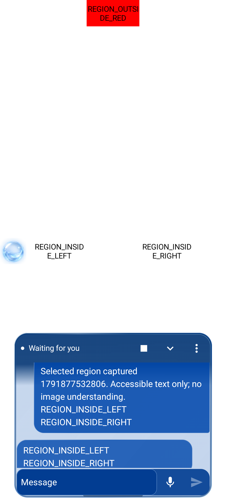
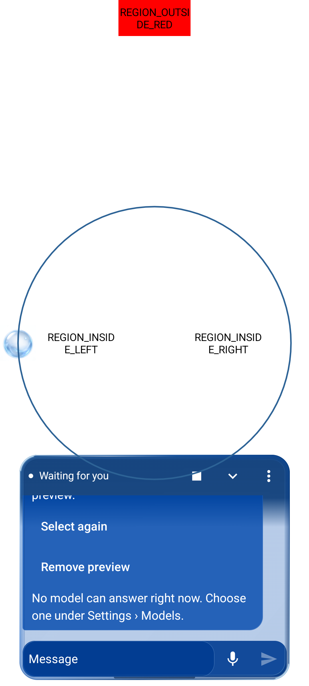
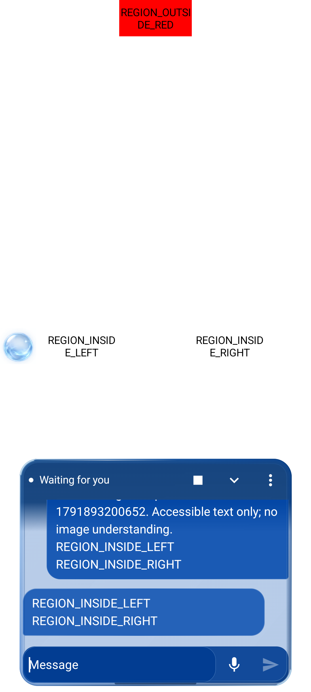
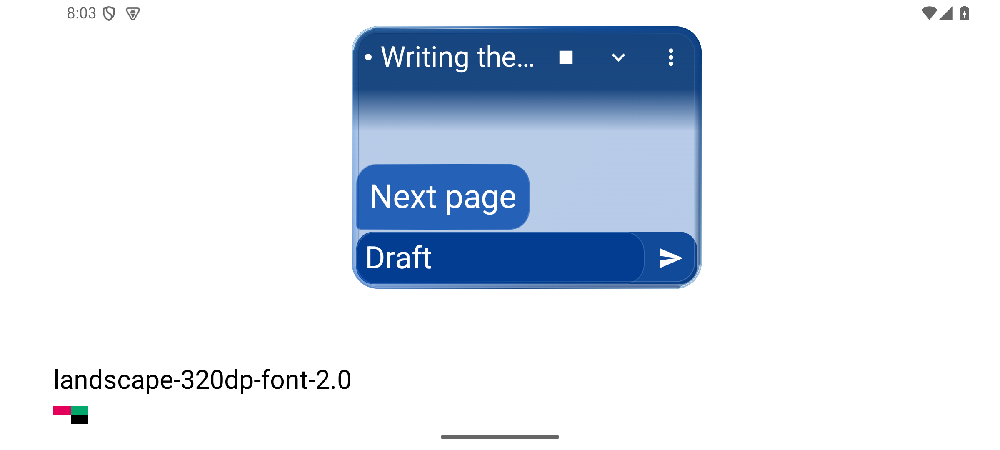
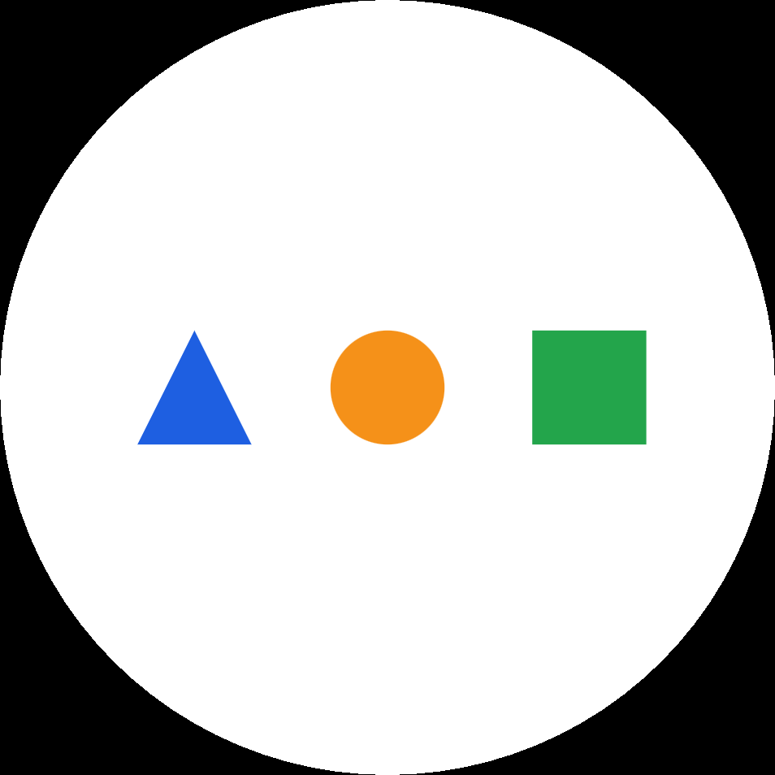
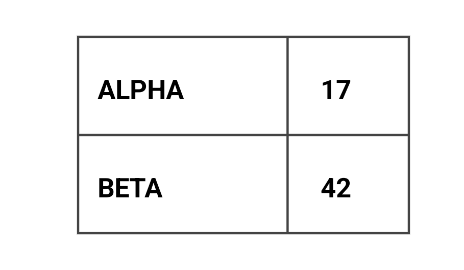
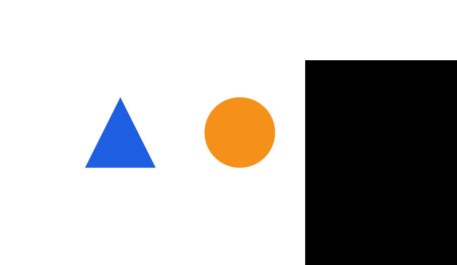

# Android verification

Use this workflow for Nanodot Android acceptance and APK delivery. The repository-local `skills/verify-nanodot-android/SKILL.md` is loaded through AGENTS.md; it is not installed globally. It adapts selected [pstack](https://github.com/cursor/plugins/tree/fe53d9e9093dbb9ae298563b1a9d702dd6e2ca08/pstack) 0.15.21 principles under MIT © 2026 Lauren Tan. The source lock and license are under that skill's `references/` directory.

A passing build, fixture and real app journey answer different questions. Keep those results separate. The original goal remains Android-first, transparent blue glass, bottom bubble chat, automatic avoidance and user-guided Care; this workflow does not complete other platforms or reopen login/gateway deployment.

## Prepare and identify {#prepare}

Use the [unified build profiles](build.md). Run commands from the repository root with the established toolchain environment. `NANODOT_ENV_FILE` may point at the existing local environment; do not load provider secrets for build checks.

```sh
bash scripts/build-nanodot-apk.sh doctor
bash scripts/build-nanodot-apk.sh check
bash scripts/build-nanodot-apk.sh debug-x86_64 --with-test
```

`check` means the full JVM suite unless `NANODOT_TEST_SCOPE=nanomuse` is explicitly selected; report that narrower scope. `debug-x86_64` is the emulator candidate, while `debug --with-test` builds the arm64 pair. Neither x86 success nor a local native cache proves arm64 runtime behavior. Preserve receipt cache provenance.

Set `NANODOT_RECEIPT` to the exact `receipt.json` printed by the chosen build, not the newest file found by a glob. Set `NANODOT_QA_HOME` to the already-owned local harness directory from the current handoff. It contains `install-candidate.py`, `run-native-case.py`, the QA mode guard and the live bridge. These local helpers are not bundled in the APK or downloaded by this skill. Inspect them before reuse; if absent, record the harness prerequisite rather than silently constructing a second driver.

```sh
: "${NANODOT_RECEIPT:?select the explicit paired candidate receipt}"
: "${NANODOT_QA_HOME:?locate the existing owned QA harness}"
python3 scripts/android/check_verification_evidence.py receipt "$NANODOT_RECEIPT"
```

The checker reads local bytes only. Certificate fields must agree, but actual signature verification remains the build's `apksigner` evidence. It does not establish current installed state.

## Native doctor and sidebar {#doctor}

One coordinator owns Gradle and the device. The existing local harness is pinned to `emulator-5586` / `Nanodot_V2_QA`; never drive `emulator-5584` or a shared device by default. Before first drive and after a surprising failure, directly inspect identity and the installed APK hashes:

```sh
"$ANDROID_HOME/platform-tools/adb" -s emulator-5586 emu avd name
"$ANDROID_HOME/platform-tools/adb" -s emulator-5586 shell getprop ro.product.cpu.abi
"$ANDROID_HOME/platform-tools/adb" -s emulator-5586 shell pm path io.github.nanodot.app
"$ANDROID_HOME/platform-tools/adb" -s emulator-5586 shell pm path io.github.nanodot.app.test
```

Read `sha256sum` for the exact returned APK paths and compare with the receipt. Record API, locale, font scale, theme, rotation and animation settings. Inspect the current loopback bridge health and decoded video, not just a cached screenshot or open tab. Keep the private sidebar authentication URL out of logs and commits. Never clear app data, replace signing identity or alter another guest to repair a mismatch.

Use the guarded installer for a changed candidate:

```sh
python3 "$NANODOT_QA_HOME/install-candidate.py" "$NANODOT_RECEIPT"
python3 scripts/android/check_verification_evidence.py receipt "$NANODOT_RECEIPT" \
  --installed "$NANODOT_QA_HOME/installed-candidate.json"
```

The second command compares the saved installation record, not a fresh device query. Keep the direct observations and their time in the run record. A partial install must be repaired before testing the pair.

## Drive and capture {#drive}

Read `skills/verify-nanodot-android/references/features.md`. Select the changed feature's actual user route and explicit fixture method. Set `NANODOT_CASE` to a new lowercase label using letters, digits and hyphens; the runner refuses an existing directory.

```sh
: "${NANODOT_CASE:?choose a fresh evidence label}"
python3 "$NANODOT_QA_HOME/run-native-case.py" "$NANODOT_CASE" \
  'io.github.nanomuse.dot.chat.DotForegroundLayoutTest#transcriptAndFullTouchControlRemainVisibleInShortImeAndMovedUpFramesAtAllFontScales' \
  --expected 1
python3 scripts/android/check_verification_evidence.py native \
  "$NANODOT_QA_HOME/logs/$NANODOT_CASE"
```

This is one JUnit method with multiple layout scenarios, not proof of a complete user/provider journey. The runner stores `result.json`, `instrumentation.log` and `after.png`; inspect new captures. Its guard switches the existing sidebar to automated mode and locks manual input while retaining actual video. Do not interact manually during that mode. A native timeout is bounded at 180 seconds and leaves automated mode active: stop the exact known test/app work, inspect cleanup and only then restore manual mode. Killing the adb client alone does not stop instrumentation.

For the actual product pass, launch the installed app through its launcher, enable its accessibility service through Settings if needed, return to a harmless host and use the orb. Preserve before/action/after screenshots or video, UI state and relevant logs. Verify glass readability on dense/inverse host content, bubble order, draft/history persistence, menu/IME/Back order, touch targets, temporary upward avoidance and compact behavior. Cover 200% fonts and short/IME hosts when affected. Keep the chat visible. Freeze host content and animation phase before any pixel comparison; a redesign is not required to match the old UI pixel for pixel.

Real model and voice checks need their separate authorized configuration and request/result evidence from the app. A configured key, fixture reply, injected transcript or visual recording animation is not real-provider/microphone proof. If prerequisites are missing, record that proof level as `not_run` or `blocked` and continue independent checks.

## Evidence and repair loops {#evidence}

Use `skills/verify-nanodot-android/references/run-record.md`. Record status (`not_run`, `pass`, `fail`, `blocked`) separately from proof level (`source`, `artifact_integrity`, `unit`, `native_fixture`, `native_user_flow`, `real_provider`). Bind the receipt, source fingerprint, APK hashes, device conditions, route, actions, expected/observed result, artifacts and cleanup. The offline checker deliberately cannot bind old fixture output to today's installation or judge screenshot content.

Each repair iteration has a hypothesis, one justified change and a focused check. After two unchanged failures, inspect the premise and state before another patch. Do not weaken expected behavior, erase failed evidence or repeatedly run the full matrix without a reason. Reuse a cheap deterministic regression where available; an unrelated compile error is not a behavioral RED. Keep product bugs separate from harness drift. Cleanup restores only settings/resources the check changed and retains evidence; a requested live sidebar may remain open.

| Loop | Existing owner and limit | Evidence required |
|---|---|---|
| Build/install | Unified wrapper; frozen source fingerprint and paired receipt; coordinator serializes builds/install | Byte/signature/package/ABI evidence; a changed source during build rejects the candidate |
| Native fixture | Existing runner/QA mode guard; explicit methods, 180-second limit | JUnit result plus captured actual state; timeout requires device cleanup before another attempt |
| Care | `CareController`, `CarePlanner`, `ConfiguredCarePlanner`; one provider request, 5-second capture and 30-second planning deadlines; no automatic provider retry/fallback | Current snapshot and one checkable user step; a fresh observation verifies the outcome; `UserConfirmed` stays distinct from `Observable` |
| Chat/provider/voice | Existing canonical binding and cancellation owner | Stop revokes work; late output cannot restore a stopped task; real provider/audio is measured separately from held local fixtures |
| CI/review | Existing task/PR owner and scoped review | Inspect real artifacts and actionable changes; do not auto-merge, deploy or reopen frozen services |

Care's prompt reinforces this evidence sequence without adding tools, execution, schema fields or an unlimited loop. A proposed step, elapsed time or model assertion is not completion. Keep generation/revision fences and Stop in code; prompt text cannot replace them.

## Skill validation and delivery {#delivery}

The pure Python checker can be tested without Gradle, a device or a provider:

```sh
python3 -m unittest discover -s scripts/android -p test_verification_evidence.py -v
```

A new or changed verification recipe is a draft until the coordinator runs launch/doctor/one mapped feature/evidence/cleanup on the actual target and records the result. Do not repeat already-passing unrelated suites just to demonstrate the skill. For delivery, identify the final APK's ABI, signing and SHA-256 and retain limitations. A debug APK may be installable while hardware/real-provider checks remain incomplete. Nothing in pstack grants publication or external messaging permission.

## Earlier cobalt snapshot — 2026-10-13 {#cobalt-snapshot-2026-10-13}

The cobalt-message candidate was built as paired debug APKs for x86_64 and arm64-v8a. The x86_64 main/test bytes were verified after installation on the isolated Android emulator. Both builds share source fingerprint `1cc6e334e6d357b48a555bfcd22a5ebf8c5d190c9acca15d312f8386121d6d3d`; arm64 installation/runtime has not been checked on physical hardware. These are development artifacts, not a release qualification.

- Scoped JVM checks passed. The refreshed native message-layout test passed all18 normal/short-IME/moved-up and font/sender combinations, and the glass test passed its4 theme/font combinations after fixing2px clipping at200% font size. The real split-screen/IME fixture also passed.
- One real DeepSeek text exchange returned HTTP200 and six SSE deltas, with44 input and6 output tokens. The main chat and foreground cobalt bubble displayed the same canonical reply, `Nanodot 连接正常。`. The panel was opened with a real orb tap; sending used the existing `chat.uiPrompt` entry into the shared production VM/provider, so this does not establish a physical Send-button tap.
- The provider exchange used a one-use localhost test relay that read the existing private credential only in host memory. It forwarded the real SSE unchanged, replaced system context with public test text, limited output to128 tokens and disabled tools/thinking. Default-context/tool execution, microphone input and screen interpretation are outside this proof. No credential is in the APK or repository.
- In this snapshot, normal Care controls passed, but the 200% font Back case, compact-menu Expand admission and static-outline top-edge case failed. The static outline was visibly clipped at the top; fixture admission/scroll assumptions also needed repair. Restoring the service after gallery tests exposed a separate `BadTokenException` during overlay attachment. These historical failures remain recorded; the focused follow-up below updates their status.

## Care follow-up (r13) — 2026-10-13 {#care-r13-2026-10-13}

These native fixture results belong to the installed x86_64 development pair with source fingerprint `162a7d2406d0941d8cf54d57d182fb0963a861c6f0187bbb9871a04b24a5cee4`:

| APK | SHA-256 |
|---|---|
| Main | `9fb4b7f6155aef6b7e386703db24615138777c24df72eff69a7bd71ca4dba241` |
| Test | `09e588a71d34b28b0fc445a61a0ee04c89957029a24ebd3c51c87f7b13b8f884` |

The earlier layout, glass, split-screen and real DeepSeek evidence remains bound to `1cc6e334…`; it is not a rerun on this pair.

- **Static outline: pass** (`reset-r13-static-bound`). Removing the focus window's second system-inset adjustment fixed the top-edge clipping. All four outline edges rendered and the target region stayed identical across two captures 300ms apart. The fixture checks the attached View's screen bounds and screenshot pixels; the non-touchable, non-focusable visual layer need not appear in the accessibility window list.
- **200% font controls and single Back: pass** (`reset-r13-font2-diagnostics`). The fixture retained full 48dp control admission, selected Copy within the menu, observed the host touch, and sent one Back. Back was accepted before a later observation reached `Paused`, removed the card and cleared the outline. This supports a fixture waiting issue, without proving the sole cause of the earlier failure. Production Back handling was unchanged.
- **Compact controls: guest completion, harness incomplete** (`reset-r13-compact`). After short scrolls based on the current viewport, the guest TestRunner reported one test, zero failures and zero ignored tests. The host runner exited 143 without persisting its normal stdout/result, so this is not an overall harness pass.
- **Overlay attachment remains unresolved.** One serialized service rebind and subsequent UiAutomation observation showed no new crash. This does not fix the earlier `BadTokenException` or exclude a reattachment race.

Keep the original Android-first delivery goal open. The harness limitation, unresolved attachment defect and remaining device/provider coverage prevent whole-assistant acceptance.

## Care entry and message spacing (r14) — 2026-10-13 {#care-r14-2026-10-13}

Message padding now follows the space available in the transcript. A naturally short 208dp Care card keeps 8dp above and below message text when that space is available; padding compresses only when the transcript cannot fit the scaled line and its insets. Native verification was pending at the r14 checkpoint; the r15 results follow below.

The r14 real-provider attempt used an actual orb triple-tap, goal entry and Send tap. The original production SYSTEM and user JSON were preserved; the relay only adapted the output limit to `max_tokens=1024` and disabled thinking. DeepSeek returned HTTP 200 with 1,592 input and 153 output tokens: **transport passed, product flow failed**. Care remained in `Recovering` and did not display the returned instruction.

This used a public two-page test host, so it does not establish third-party app support. Advancing the PageContains step requires explicit user confirmation, not automatic success. At this checkpoint, the fix to wait for the actual keyboard and layout to settle before Care sends was awaiting verification.


## Two visible Care plans (r15) — 2026-10-13 {#care-r15-2026-10-13}

The installed r15 pair used source fingerprint `9af766e7…`, main APK `ca33a2b7…` and test APK `582125b4…`. All 670 JVM tests passed. Two native message-layout methods passed: the natural 208dp card retained 8dp above and below the text, and the existing 18 combinations of font scale and constrained layout remained covered. Both real instruction bubbles also measured 8dp vertical padding.

A fresh run on the public two-page test host followed the actual orb triple-tap, keyboard goal entry and Start guiding tap. After the keyboard and layout settled, Care displayed the first real instruction with a blue outline around Next page. The host button was tapped; **I completed this step** explicitly confirmed the transition. Care then displayed the second real instruction and an outline around Finish. Both DeepSeek requests returned HTTP 200: attempt #16 used 1,690 total tokens and #17 used 1,834. They preserved the production SYSTEM/user content, used the 1,024-token output cap with thinking disabled, and made one upstream attempt each with no retry or refusal.

The run ended with Stop reaching `Paused`; Finish was not tapped, `Done` was not reached and there was no third request. Relay cleanup completed. This verifies two displayed plans and a user-confirmed transition on the test host, not automatic completion or third-party app coverage. Evidence is retained in `reset-r15-care-journey` and recheck run `0f619d9a-4fb3-4d14-83a0-4d872f5d03e2`.

The separate native Care input/late-reply regression now **passes** (`reset-r15-care-input-events`, one method, host exit 0, 22.204s). This rerun used the same main APK `ca33a2b7…`, updated test APK `52668f0f…` and source fingerprint `ce093aa5…`. Two actual Send taps were above the visible keyboard; both subsequent captures recorded no native IME and no IME bounds in the snapshot. The two submissions produced exactly two captures and two held local planner calls. Stop left the session `Paused` after the delayed reply was released. This is a native fixture regression with a local planner, separate from the two real DeepSeek plans above.

Both earlier failures remain recorded: `reset-r15-care-input` timed out in the `@Before` service-connection fixture; `reset-r15-care-input-rebind` passed that setup but stayed `Idle` because the isolated test window had not received the service's geometry events, leaving Send under the keyboard. The harness now waits for the framework to acknowledge removal of its own service grant, and the isolated test forwards the existing scene/geometry events before admitting a real Send tap. Neither failure establishes a new product crash. Real microphone ASR, audible TTS, historical `BadTokenException` and whole-assistant acceptance remain open. Earlier r12/r13 results retain their original APK identities.


## Unified cobalt glass UI (r16) — 2026-10-13 {#cobalt-glass-ui-pending}

The foreground chat and Care shell now uses a transparent cobalt body, an inset dark-blue edge with two fine highlights, and a continuous deeper-blue toolbar fade. Status is a small dot and live text; Stop remains a separate 48dp icon with its existing localized description. Collapse and More keep their 48dp targets. The draft, controls and menu use local cobalt reading backgrounds with paired white text; existing message colors and space-dependent 8dp padding remain intact. The palette is scoped to the foreground components. These drawn edges do not sample, blur or refract another app's pixels.

The installed x86_64 pair used source fingerprint `c9f984c6…`, main APK `e1645b9d…` and test APK `5df3ccfe…`. All 670 scoped JVM tests passed. Native acceptance passed the unchanged glass test in four light/dark and font combinations (`reset-r16-glass`), retaining its 4.5:1 status/text and 0.55 host-contrast thresholds. The 200% dark-theme screenshot retained 0.663 host contrast.

Both new `DotForegroundAdaptiveLayoutTest` methods passed (`reset-r16-adaptive`): 240/320/400dp widths at 100%/200% font size, plus those three widths in actual landscape at 200%. They measured complete, non-overlapping 48dp Stop/Collapse/More targets, usable history/input and an unclipped short Care message; physical touches reached the three respective callbacks/menu. Only the fixture Activity requested landscape, and its original orientation request and font configuration were restored. Some saved captures include the system rotation transition; the measurements and action assertions are not a claim that every screenshot is a settled animation frame. This matrix does not establish all locales, recording controls, tablets or arbitrary split-screen sizes.

After restoring the existing service session, a real orb triple-tap on the public two-page host opened the new bottom Care card (`reset-r16-glass-live/cobalt-care`), with its local cobalt input, chat bubble and separate icon controls visible. No provider call was made by this visual check. The earlier r15 real-provider results retain their recorded APK identities; they do not qualify this revision's pixels. This is transparent tint and drawn optical edging, not verified cross-app refraction. The historical service reattachment issue and original whole-assistant goal remain open.


## Region selection and physical Send — 2026-10-13 {#region-physical-send-2026-10-13}

The API 35 x86_64 emulator run `ce4b853a-8a4f-46ee-8cb0-677466a8ab0f` completed an actual closed orb drag on a public test host, captured the masked preview and selected accessible text, entered the prompt with native keyboard events and tapped the visible Send control. The shared production conversation displayed the genuine DeepSeek reply, `REGION_INSIDE_LEFT REGION_INSIDE_RIGHT`. Both inside labels were present; the outside label was absent from the selected text and request. The encoded crop also excluded outside red pixels. The screenshots below are actual device captures.





The installed pair was bound to source fingerprint `777ff4ad06bb5f242402afbcfffc1769c431769c7d1994b0b94c3ccffbf316f3`, main APK `49c360473ddae0214c2db4508d0326f7108e193ecee8c54cf1495a30a2556ebb` and test APK `472ab5689fe78f1f78abfaf04582c165edbc0d6446d97e224e07595425161672`. This was a dirty development candidate based on `819c65616b4d`; later build receipts must retain their own source identities. Native session/user/reply hashes were joined to the relay's original and forwarded user hashes. JUnit, PNG integrity, native evidence and real-provider checks passed; the post-instrumentation cleanup frame is not the reply screenshot.

The separately authorized ledger used one of two allowed upstream attempts, without an automatic retry; the older 17/17 ledger stayed unchanged. HTTP 200 returned 7,130 input and 14 output tokens, a final stop and SSE DONE. Production SYSTEM/user messages were preserved; the one-use host relay capped output at 128 tokens and disabled thinking/tools. Configuration RPC selected the isolated provider; it did not inject a draft, Send or reply. The temporary provider, routes and arm file were removed, provider count returned to zero, and manual QA mode was restored.

The same main APK separately passed actual open drag, circle, Select again, rectangle and Stop regression (`repair-main-region-shapes-r1`); encoded crop masking and native keyboard entry also passed. The first live run failed in keyboard input before any upstream request, and its original failure evidence remains retained. Keyboard/Send observations now wait for actual IME and stable bounds with finite deadlines.

This proves selected accessible-node text through a real provider on the controlled host. It does not prove OCR, canvas/image understanding, arbitrary third-party apps, older Android runtime behavior, arm64 hardware, microphone/TTS, default tool execution or full assistant acceptance. The supplemental controlled late-capture/host/rotation fixture passed all three explicit methods (`repair-region-lifecycle-r2`, 8.412 seconds). It holds a sampler, waits for stable actual 48dp Stop geometry and checks exact ticket/binding revocation before late delivery; host loss and rotation also require actual panel collapse. The original r1 failures remain recorded: Stop was sampled before layout settled, while the other cases expected an error after the request had already been cancelled. The main APK remained `49c360…`; the r2 paired receipt retains the changed test APK identity. This fixture is separate from the ordinary orb/provider journey and does not prove every service-rebind race. The actual sidebar live-video view remains unverified; the retained device recording and screenshots provide inspectable evidence.


## Glass depth and transcript following — 2026-10-13 {#glass-depth-transcript-2026-10-13}

The card now has a 28% cobalt body, a fading 7dp inward edge and short corner highlights. Input/bubble borders are quieter; the existing passive Waiting status and separate 48dp actions remain. Native glass checks on main APK `51e15fc4c4de6cdf9c6ba444ef5db52dc8902b970c84e58fd36a1e71cf2252b1` retained host luminance difference 0.5849 (minimum 0.55) and the existing 4.5:1 glyph contrast checks across four theme/font cases. The effect is drawn depth, with no host blur or cross-app refraction.

Stable-id streaming previously left the reply bottom at 970px in a 451px viewport. Measured-layout following now passes growth, finalization and viewport shrink. Native physical swipes preserve older reading, then resume following after returning to the end. Five methods passed in `polish-green-layout-r2`: the two transcript methods, nine adaptive scenes (240/320/400dp, normal/200% font, including landscape), and screenshot-oracle negatives. Adaptive captures require current scene markers, stable geometry, matching orientation, full PNG round-trip equality and physical menu dismissal. Short messages and controls fit; narrow status copy still ellipsizes with its full accessibility description.

The 18-case short/keyboard/moved-up layout fixture and actual split-screen/IME method passed in `polish-green-ime`. Display size/density, font scale and rotation were restored. All 706 scoped JVM tests in 102 suites passed. The first combined native run passed the reply-tail and glass methods but failed at a temporarily absent accessibility root before the reading gesture; a bounded target-window readiness check fixed the fixture, and both transcript methods subsequently passed. Failure records remain retained. Glass used test APK `5b89963a…`; later checks used `a37019fbfe56c72b92e90df3eec250c8990ce71e49295521ed315666597eda20`, with identical main APK bytes. The paired development receipt has source fingerprint `2168b4f4912c219a1097051272cfd8c59aba650970ebac070d7c8401330fba01`.

Actual circle, Select again, rectangle and Stop passed in `polish-region-shapes`, with a device recording. Real-provider run `2947bd3e-ef29-4c98-88a2-8a3e785a7137` then used a closed orb drag, selected accessible text, native keyboard and physical Send. The same conversation displayed the complete two-line reply below. One upstream request returned HTTP 200, 7,130 input/14 output tokens and SSE DONE; canonical user hashes matched. The independent region budget is now 2/2, with no automatic retry and the older budget unchanged. The temporary provider and owned routes were removed, provider count returned to zero and manual input was restored.







These results prove controlled-host accessible-node recognition, not OCR or image understanding. Arm64 hardware, arbitrary apps/locales and a drag interrupting an active follow animation remain outside this runtime evidence. Sidebar file openings returned queued; a live sidebar video view remains unverified. Actual device PNGs and recordings are retained separately from the earlier generated concept.

## Raster region recognition and continuous live journey — 2026-10-13 {#raster-region-live-2026-10-13}

Run `d882fbdc-ab84-4ca2-a4f3-4b5bf3301d71` completed on the API 35 x86_64 emulator: actual Care entry, native goal entry and Send, orb circle selection, image question, a follow-up about the same image, rectangle selection and table transcription, irregular selection and a final unsent preview cancelled with Stop. Four canonical chat turns retained three historical images. Care supplied node-based guidance about the accessible **Inspect card** button; selection paused Care, with zero verified steps. The image questions ran in the shared Screen conversation, not the Care planner.

The controlled host draws the colored objects and table on Canvas, without accessibility text describing their answers. Image-capable region requests now include the user's question and masked PNG, without appending selected-node text; the existing text-only fallback remains separate. Three original crops matched the uploaded and durable image bytes. Follow-up used one historical image with no new attachment; later requests retained history and attached the new selection. No answer, OCR transcript or replacement SYSTEM prompt was inserted by the harness.

| Actual question | Core result | Full-answer qualification |
|---|---|---|
| Circle: list colored symbols | Blue triangle, orange circle, green square, in order | Incorrect extra claim that the triangle is equilateral |
| Same-image follow-up: leftmost symbol | Blue triangle | No error found |
| Rectangle: transcribe table | ALPHA → 17; BETA → 42 | No error found; explicitly notes no original header |
| Irregular region: visible symbols | Blue triangle and orange circle; masked green square excluded | Incorrect extra equilateral claim; correctly sees the black mask without identifying its role |

Independent review inspected all three actual upstream PNGs and all four complete answers. **Core recognition was 4/4; only 2/4 full answers were free of detected errors.** The blue triangle's raster height/base ratio is 1.0, not the approximately 0.866 of an equilateral triangle. These extra errors are retained, not hidden by a keyword score. The isolated run used exactly five real DeepSeek calls (one Care, four chat), all HTTP 200 and completed, without retry. Production message hashes were preserved. The explicit output limits were 1,024 tokens for Care and 256 for chat, with thinking/tools disabled. The temporary provider and owned routes were removed, provider count returned to zero, and manual input was restored. Older attempt ledgers were untouched.







The retained device video `vision-live.mp4` is a continuous 1080×2400 H.264 recording, fully decoded as 2,852 frames over 115.636 seconds (SHA-256 `bb9f56b13542f976a1e83bd7377af909ee08699a4dbe7ce2c0f8eef033701045`). During this run the existing sidebar was visibly receiving the scrcpy stream: actual observations included Care, keyboard/selected preview, table reply in progress and the cleanup screen. Decoded frame counts and timestamps advanced in one session; final manual controls were available. This confirms an operating live sidebar, not continuous human observation of every phase. Local recording, full responses, native receipts and independent grading are retained together in the task's `Nanodot-Vision-Live-2026-10-13` output directory.

This journey used main APK `a153a6fa91f93fa7c9797c9b22db2084b8727f922e8f3b93490fd5d6d70b2e2a` and test APK `872eec0d6fbacbd8f0e2ba1f35ad636877fe9eac2f693b3c4c21982863cea0a1`, a development candidate based on `774cc5bc5c40`. Scoped JVM checks passed 709 tests in 102 suites, with no failures, errors or skips. A full five-call simulated rehearsal passed before the real run. Production fixes retain the focused panel during reselection and hold the Care card until Screen focus is admitted; Stop revokes pending ownership. Care now uses fresh nodes directly, keeping host-window capture bounds and avoiding an unused screenshot request. The node-route negative test and two host-boundary tests were observed failing before their corresponding fixes and passing afterwards.

These are controlled Canvas image-understanding and simple raster-table results, not a published benchmark score or general OCR accuracy estimate. [AndroidWorld and MobileMiniWoB++](https://github.com/google-research/android_world) supply relevant state-checked mobile tasks, especially color/shape identification, table reading and drag interaction; [AndroidControl](https://github.com/google-research/google-research/tree/master/android_control) supplies recorded mobile actions. The local benchmark task cards separate these source tasks from Nanodot's eight adaptations and keep unrun rotation/open-path/self-intersection cases pending. Arbitrary third-party apps, real arm64 devices, API 26–33, microphone/TTS, default tools, broader localization and full Care task completion remain outside this run. Previous UI/adaptive results above retain their own APK identities.


The final no-provider regression `vision-regressions-r13` passed all three explicit node-route, local region and focus-cancellation methods (51.128s; zero skipped/failed tests). Main APK bytes remained `a153a6fa…`; the test-only fixture correction produced test APK `d7c1af75fbd7df097a8e1180f518e617d311eadd90caca89c28cde211738f7a7`. The earlier combined run passed the first two methods but failed cancellation setup because package-only host readiness could admit the previous Activity. Requiring the same focused fixture window, both exact visible markers and two stable scene/bounds observations repaired that precondition without weakening the actual Stop assertion. Physical old-Care Stop cancelled a deliberately nonfocusable Screen admission, removed outline/preview, made zero sampler/provider calls and allowed Care reentry. The old job completed before reentry, so a forced late-finalizer interleaving remains source-reviewed only. Original failure evidence is retained.
