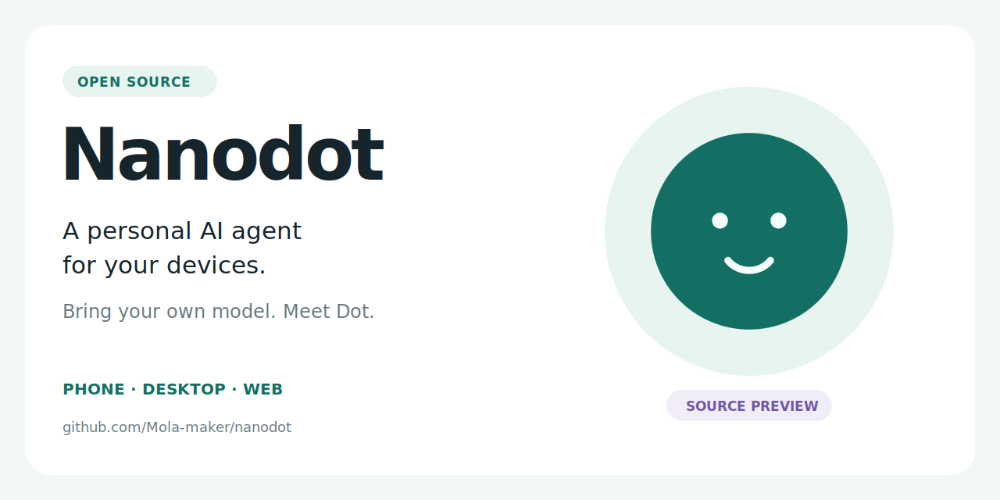
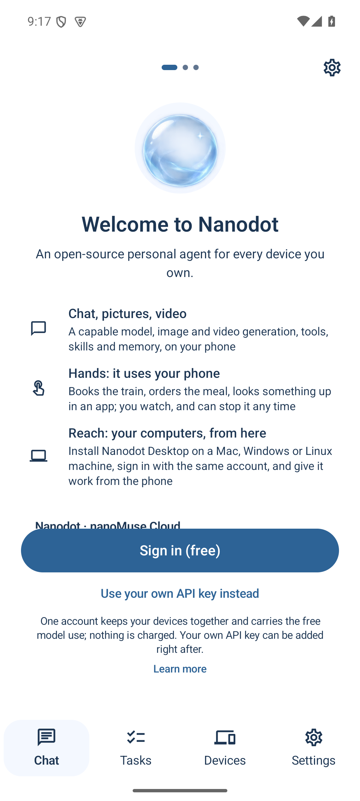
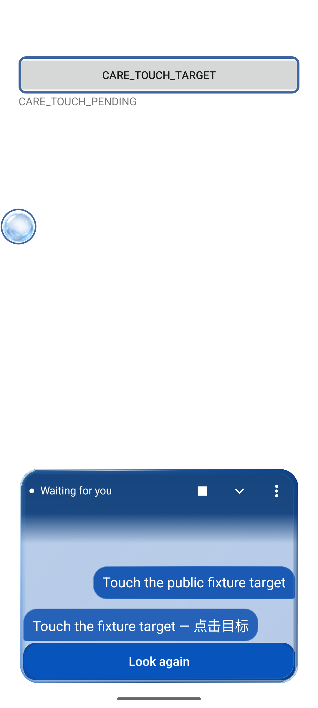

# Nanodot

<p align="center"></p>

<p align="center"><strong>使用自己的模型，在手机、电脑或浏览器里与 Dot 一起完成任务。</strong></p>

<p align="center">
  <a href="../../LICENSE"></a>
  <a href="../../pyproject.toml"></a>
  <a href="../zh/build.md"></a>
  <a href="#项目状态"></a>
</p>

<p align="center"><a href="#快速开始">快速开始</a> · <a href="../zh/index.md">文档</a> · <a href="../../README.md">English</a> · <a href="https://github.com/Mola-maker/nanodot/issues">反馈</a> · <a href="#参与项目">参与项目</a></p>

<details>
<summary>其他语言</summary>

[繁體中文](https://github.com/Mola-maker/nanodot/blob/main/docs/readme/README_zh-TW.md) | [Español](https://github.com/Mola-maker/nanodot/blob/main/docs/readme/README_es.md) | [Français](https://github.com/Mola-maker/nanodot/blob/main/docs/readme/README_fr.md) | [Bahasa Indonesia](https://github.com/Mola-maker/nanodot/blob/main/docs/readme/README_id.md) | [日本語](https://github.com/Mola-maker/nanodot/blob/main/docs/readme/README_ja.md) | [한국어](https://github.com/Mola-maker/nanodot/blob/main/docs/readme/README_ko.md) | [Русский](https://github.com/Mola-maker/nanodot/blob/main/docs/readme/README_ru.md) | [Tiếng Việt](https://github.com/Mola-maker/nanodot/blob/main/docs/readme/README_vi.md)

</details>

Nanodot 是一个开源个人 AI 智能体，默认助手叫 **Dot**。它将对话、工具、记忆和定时任务放在一起，仓库包含 Android 与 iOS App 源码、桌面外壳、Web 控制台和 Python 运行时。项目基于 [nanoMuse](https://github.com/nano-muse/nanoMuse)，手机端基于 [OpenMinis 1.13](https://github.com/OpenMinis/OpenMinis)。

## Android 预发布 · 1.1.0 Crystal

**[下载 Android APK](https://github.com/Mola-maker/nanodot/releases/download/v1.1.0/Nanodot-1.1.0-arm64.apk)** · [发布页与校验值](https://github.com/Mola-maker/nanodot/releases/tag/v1.1.0) · [发布说明](../releases/v1.1.0.md)

这是 Nanodot 的首个 Android 预发布，适用于 **Android 8.0+ / ARM64**，版本 **1.1.0**（versionCode **45**）。安装包为 `Nanodot-1.1.0-arm64.apk`，使用 Nanodot 专用发行密钥签名；同时下载 [SHA-256 文件](https://github.com/Mola-maker/nanodot/releases/download/v1.1.0/Nanodot-1.1.0-arm64.apk.sha256)可校验文件。替换使用不同签名的开发包前，请先阅读安装说明。

## 这个预览版包含什么

- **水晶 Dot。** 带呼吸动画与拖动轨迹的水晶悬浮球，以及蓝色玻璃面板中的前台对话。
- **圈选后提问。** 选择屏幕区域，查看本地预览，再发送问题。明确配置为支持图像的模型会收到遮罩后的图片；其他模型使用选区内可获取的文字。
- **Care 关怀引导。** 根据目标描边与文字提示操作，明确确认已完成的步骤，也可随时使用 Stop。临时提示消失后，完整指令仍保留在对话中。

主题默认跟随系统。自定义名字、SOUL.md、头像、动画、模型与偏好保留。连续语音与自动更新默认关闭，请手动查看本仓库发布页。

## Android 实际截图

<table>
  <tr><th>Nanodot 首页</th><th>Care 对话</th></tr>
  <tr><td></td><td></td></tr>
</table>

以上是此前开发候选包在 API 35 模拟器上的实际截图。Care 示例使用受控测试页面与本地 planner，用于展示界面，不代表本次签名 1.1.0 APK 已重新完成运行验收。各 APK 身份与测试边界见[带日期的验收记录](../zh/android-verification.md#main-care-trace-2026-10-14)。

**预发布边界。** 真实模型驱动的完整 Care 任务成功闭环、任意第三方应用、ARM64 真机、较旧 Android 版本、中文麦克风识别与可听语音仍需更广泛验收。受控图片提问的核心结果为 4/4 正确，但完整回答仅 2/4 未发现错误；[完整记录](../zh/android-verification.md#raster-region-live-2026-10-13)保留了这些错误。本次发布不代表当前 iOS 或桌面端运行验收已完成。

## 可以和 Dot 一起做什么

| 用途 | 项目提供的能力 | 进一步了解 |
|---|---|---|
| 资料整理与日常工作 | 使用自己选择的模型对话，通过搜索、文件和 shell 工具把请求变成输出。 | [工具与配置](../zh/configuration.md) |
| 持续推进的工作 | 记忆、目标、提醒与例程；定时工作需要智能体持续运行。 | [CLI](../zh/cli.md) |
| 自己的工作流 | 使用技能和 MCP 服务器扩展智能体。 | [技能与 MCP](../zh/configuration.md#skills) |
| 手机与电脑任务 | 屏幕操作实现，需要对应平台的权限，并受平台能力限制；iOS 不能操作其他 App。 | [手机](../zh/android.md) · [电脑操作](../zh/gui.md) |
| 多个设备上的入口 | 本地 Web 控制台，以及通过中继实现的可选设备与对话集成。 | [Web](../zh/web.md) · [设备](../zh/device.md) |

这些能力来自继承的实现。Nanodot 的打包与设备验收状态见下文；实际可用的工具取决于模型支持与平台权限。

## 快速开始

### 体验 Python 运行时与 Web 控制台

需要 **Python 3.11+** 和已配置的模型服务商。从本仓库安装，以获取 Nanodot 源码；软件包和 CLI 保留内部名称 `nanomuse`。

```sh
git clone https://github.com/Mola-maker/nanodot.git
cd nanodot
python3 -m venv .venv
. .venv/bin/activate
python -m pip install -e .
nanomuse config init
```

Windows 使用 `py -m venv .venv`，并在 PowerShell 中执行 `.venv\Scripts\Activate.ps1` 激活。编辑 `config/config.toml` 的 `[llm]` 部分，配置服务商、模型、端点和 API key 环境变量。参见[配置示例](../../config/config.example.toml)与[自己的 key](../zh/own-key.md)。模型 API 可能按服务商规则计费；默认配置不提供 key 或额度。

```sh
nanomuse doctor       # Check your configuration and available tools.
nanomuse chat         # Start a conversation in the terminal.
# Or start the local Web console:
nanomuse serve
```

打开 `serve` 打印的本地地址，并保留其中的认证信息。默认仅监听本地；开放远程访问前请阅读 [Web 配置](../zh/web.md)。

可以先试一个小任务：**“帮我创建下次旅行的检查清单，并保存到 trip.md。”** 按提示查看工具审批。浏览器自动化与桌面屏幕操作需要[额外配置](../zh/every-device.md)。

### 构建 Android App

Android 目标为 **Android 8+、ARM64**。先按[构建指南](../zh/build.md)准备 JDK 21、Android SDK/NDK、Go 与原生依赖，再执行：

```sh
bash scripts/build-nanodot-apk.sh debug
```

脚本将 APK 与验证记录写入 `dist/nanodot/`。debug 包使用 debug 签名；release 构建需要独立签名密钥。脚本不会发布版本。在「设置 → 模型」中配置模型后，可以从文字对话开始。

## 项目状态

**1.1.0 Crystal 是首个 Nanodot Android 预发布版**，versionCode 为 **45**。带独立签名的 arm64 APK 及校验文件位于[发布页](https://github.com/Mola-maker/nanodot/releases/tag/v1.1.0)。

| 部分 | 当前边界 |
|---|---|
| Android | 包含水晶球、前台对话、区域提问与用户执行的关怀引导；上方运行证据仍绑定原开发 APK。 |
| 发布签名 | 使用独立发布证书，不能直接覆盖此前的 debug 包；数据迁移与真机验收仍待完成。 |
| 桌面与 iOS | 已有源码与构建配置；本次不分发桌面或 iOS 包，也不代表其运行验收已完成。 |
| 模型与更新 | 配置自己的模型服务商；自动更新与连续语音默认关闭。 |

无障碍等权限需要你在设备上明确开启。上游 nanoMuse APK、桌面安装器与 TestFlight 构建属于另一个产品。

## 模型、数据与权限

- **使用自己的模型服务商。** 继承的运行时与客户端支持服务商配置；可用能力取决于所选模型。参见[自己的 key](../zh/own-key.md)。
- **查看操作审批。** Python 运行时的[哨兵（Sentinel）](../zh/sentinel.md)处理工具审批；手机与电脑操作还需要对应平台权限。
- **了解数据流向。** 本地执行仍会在推理时向模型服务商发送提示词与选中的内容。参见[隐私](../zh/privacy.md)与[数据控制](../zh/sync.md)。
- **可选上游服务保留原身份。** nanoMuse Cloud 是上游服务；Nanodot 不运营该服务，也不承诺其可用性或免费额度，账号与政策由服务提供方管理。

Android applicationId 为 `io.github.nanodot.app`，外部 scheme 为 `nanodot://`。内部包、`minis://` 路由与沙箱路径保留。Nanodot 使用独立私有存储；迁移 nanoMuse 数据需要明确执行受支持的导出/导入。

## 文档

[从这里开始](../zh/index.md) · [构建](../zh/build.md) · [配置](../zh/configuration.md) · [架构](../zh/architecture.md) · [排查问题](../zh/troubleshooting.md) · [更新日志](../../CHANGELOG.md)

平台与运行时文档包含继承的 nanoMuse 实现说明，阅读时请同时参考 [Nanodot 构建边界](../zh/build.md#other-platforms-and-acceptance)。

## 参与项目

用户与开发者都可以参与：

- **试一个工作流**，并[反馈结果](https://github.com/Mola-maker/nanodot/issues/new/choose)，写明源码版本、平台、模型与复现步骤；请勿包含凭据和私人内容。
- **改善首次使用体验**，补充文档、翻译或平台构建说明。先阅读 [CONTRIBUTING.md](../../CONTRIBUTING.md) 与 [AGENTS.md](../../AGENTS.md)，提交需带 DCO sign-off。
- **分享一个具体例子**，附上本仓库链接。如果 Nanodot 对你有帮助，GitHub star 能帮助更多人发现项目。

项目反馈请使用 [Nanodot issues](https://github.com/Mola-maker/nanodot/issues)。许可为 [GPL-3.0-or-later](../../LICENSE)，上游署名保留在 [NOTICE](../../NOTICE) 与 [THIRD_PARTY_NOTICES.md](../../THIRD_PARTY_NOTICES.md)。Nanodot 与 Meta 及其 Muse 商标无关。

## 上游历史与署名

以下动态、论文引用、维护者与贡献者卡片、致谢来自 nanoMuse。原有日期、名字与链接保持，指向上游项目，不代表 Nanodot 的发布或维护者。

<details>
<summary>nanoMuse</summary>

## 🗞️ 动态

- `2026-10-09` 🚀 版本 [1.0.0 Keel](https://github.com/nano-muse/nanoMuse/releases/tag/v1.0.0) 发布，手机、电脑和浏览器都有；装在上一版之上，数据保留，每一处改动都写在发布说明里。
- `2026-10-08` 🤗 我们的论文登上 [Hugging Face Daily Papers](https://huggingface.co/papers/2610.08699)，在 10 月 8 日的榜单上排第三；欢迎到论文页提问和留言。
- `2026-10-07` 📄 我们的论文已发布在 [arXiv](https://arxiv.org/abs/2610.08699)：《nanoMuse: An Open-Source Personal Agent for Every Device You Own》，作者 Guangyi Liu、Yong Liu、Jiangning Zhang（浙江大学）；引用格式见本页末尾。
- `2026-09-25` 🎉 nanoMuse 以 GPL-3.0-or-later 发布在 GitHub：一个基于 OpenMinis 1.13 的 Android 应用；中继、电脑端和 iPhone 版在随后几天陆续到来。

全部版本：[releases](https://github.com/nano-muse/nanoMuse/releases)。

## 维护者

<table>
  <tr>
    <td align="center"><a href="https://github.com/lgy0404"><br><strong>Guangyi Liu</strong></a><br><a href="mailto:guangyiliu@zju.edu.cn"></a></td>
  </tr>
</table>

## 社区贡献者

每一位有改动合并进 `main` 的人，取自 GitHub 的贡献者列表。

<!-- contributors:start -->
<p>
<a href="https://github.com/wsvn53"></a>
<a href="https://github.com/aliabbas6622"></a>
<a href="https://github.com/PovedaAqui"></a>
<a href="https://github.com/jiangkaiqi2005"></a>
</p>
<!-- contributors:end -->

## ⭐️ 引用

如果 nanoMuse 对你有帮助，欢迎引用我们的论文。

```bibtex
@misc{liu2026nanomuseopensourcepersonalagent,
      title={nanoMuse: An Open-Source Personal Agent for Every Device You Own}, 
      author={Guangyi Liu and Yong Liu and Jiangning Zhang},
      year={2026},
      eprint={2610.08699},
      archivePrefix={arXiv},
      primaryClass={cs.AI},
      url={https://arxiv.org/abs/2610.08699}, 
}
```

## 致谢

nanoMuse 站在别人的工作之上；条款见 [THIRD_PARTY_NOTICES.md](../../THIRD_PARTY_NOTICES.md)。

- [OpenMinis](https://github.com/OpenMinis/OpenMinis)：手机 App 所基于的端侧智能体，沙箱来自 [proot](https://github.com/nano-muse/proot) 和 [Alpine Linux](https://alpinelinux.org/)。
- [DeepSeek Harness](https://github.com/deepseek-ai/deepseek-harness)：桌面 App 作为插件运行在它上面。
- [UI-TARS-desktop](https://github.com/bytedance/UI-TARS-desktop)（字节跳动）：桌面端「手」的操作器移植自它，舞台上的标记参考它的 ScreenMarker。
- [MobileGym](https://github.com/Purewhiter/mobilegym)、[MemGUI-Bench](https://github.com/lgy0404/MemGUI-Bench)、[PhoneHarness](https://github.com/PhoneHarness/PhoneHarness)、[CopilotKit/OpenMuse](https://github.com/CopilotKit/OpenMuse)、[Open-AutoGLM](https://github.com/zai-org/Open-AutoGLM)、[ClawGUI](https://github.com/ZJU-REAL/ClawGUI)：手机操作器、轨迹和产品思路。

</details>

<p align="center"></p>
