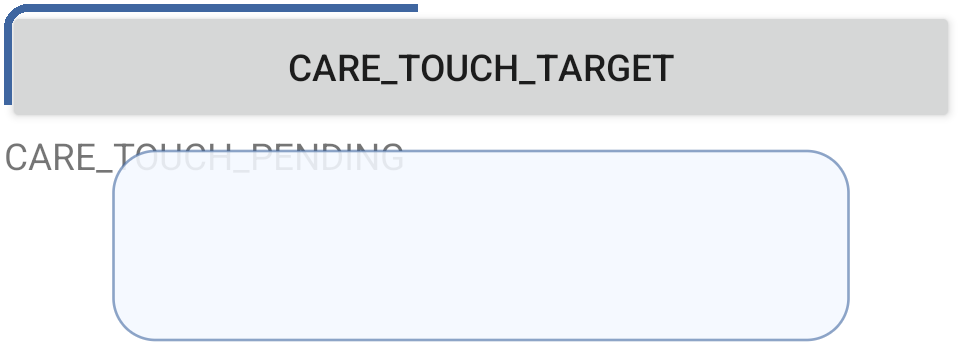
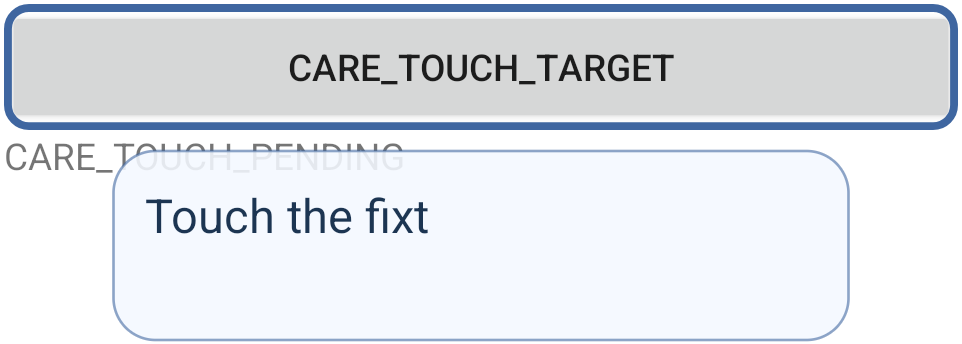

# Android 验收

此流程用于 Nanodot Android 验收与 APK 交付。仓库内的 `skills/verify-nanodot-android/SKILL.md` 通过 AGENTS.md 入口读取，没有全局安装。它适配 [pstack](https://github.com/cursor/plugins/tree/fe53d9e9093dbb9ae298563b1a9d702dd6e2ca08/pstack) 0.15.21 的部分原则，保留 MIT © 2026 Lauren Tan 许可；来源锁与许可证位于技能的 `references/` 目录。

构建通过、测试夹具通过和真实应用操作通过回答的是不同问题，应分别记录。原始目标仍是 Android 优先、透明蓝色玻璃、底部气泡聊天、自动避让和用户操作的关怀模式；此流程不代表其他平台完成，也不重启登录或网关部署。

## 准备与标识 {#prepare}

使用[统一构建配置](build.md)。在仓库根目录、已有工具链环境下执行命令。`NANODOT_ENV_FILE` 可指向现有本地环境文件；构建检查不需要加载服务商密钥。

```sh
bash scripts/build-nanodot-apk.sh doctor
bash scripts/build-nanodot-apk.sh check
bash scripts/build-nanodot-apk.sh debug-x86_64 --with-test
```

`check` 默认运行完整 JVM 测试；只有显式选择 `NANODOT_TEST_SCOPE=nanomuse` 时才缩小范围，报告必须注明。`debug-x86_64` 用于模拟器，`debug --with-test` 生成 arm64 主包/测试包。x86 通过或本地原生缓存均不能证明 arm64 运行行为，保留收据中的缓存来源限制。

将 `NANODOT_RECEIPT` 设为所选构建明确输出的 `receipt.json`，不要用通配符猜“最新文件”。从当前交接记录找到已有、归本任务所有的 QA 目录并设置 `NANODOT_QA_HOME`。其中应有 `install-candidate.py`、`run-native-case.py`、QA 模式守卫与实时桥接程序。这些本地辅助工具不打入 APK，技能也不下载它们。复用前检查源码；缺失时明确记录前提，不另造一套驱动。

```sh
: "${NANODOT_RECEIPT:?select the explicit paired candidate receipt}"
: "${NANODOT_QA_HOME:?locate the existing owned QA harness}"
python3 scripts/android/check_verification_evidence.py receipt "$NANODOT_RECEIPT"
```

检查器只读本地字节。它要求证书字段一致，真实签名验证仍以构建时的 `apksigner` 证据为准；它不证明设备此刻装了什么。

## 原生状态检查与侧栏 {#doctor}

由一个协调者独占 Gradle 与设备。当前本地驱动固定为 `emulator-5586` / `Nanodot_V2_QA`，不得默认操作 `emulator-5584` 或共享设备。首次操作和异常失败后，直接核对身份与安装包哈希：

```sh
"$ANDROID_HOME/platform-tools/adb" -s emulator-5586 emu avd name
"$ANDROID_HOME/platform-tools/adb" -s emulator-5586 shell getprop ro.product.cpu.abi
"$ANDROID_HOME/platform-tools/adb" -s emulator-5586 shell pm path io.github.nanodot.app
"$ANDROID_HOME/platform-tools/adb" -s emulator-5586 shell pm path io.github.nanodot.app.test
```

对返回的确切 APK 路径读取 `sha256sum` 并与收据比较。记录 API、语言、字体缩放、主题、旋转和动画设置。检查当前本地桥接服务健康状态与真实解码视频，不能只看缓存截图或已打开的标签。侧栏私密认证 URL 不进入日志和提交。不要通过清空应用数据、更换签名或改动另一台虚拟机来消除不匹配。

更换构建时使用已有守卫安装器：

```sh
python3 "$NANODOT_QA_HOME/install-candidate.py" "$NANODOT_RECEIPT"
python3 scripts/android/check_verification_evidence.py receipt "$NANODOT_RECEIPT" \
  --installed "$NANODOT_QA_HOME/installed-candidate.json"
```

第二条命令比较保存的安装记录，不会重新查询设备。将直接观察及其时间写进本轮记录。主包/测试包部分安装失败时，先修复这对包再测试。

## 操作与取证 {#drive}

阅读 `skills/verify-nanodot-android/references/features.md`，选择本次改动相关的真实用户入口和明确的测试方法。`NANODOT_CASE` 使用全新的小写字母、数字、连字符标签；驱动拒绝覆盖已有目录。

```sh
: "${NANODOT_CASE:?choose a fresh evidence label}"
python3 "$NANODOT_QA_HOME/run-native-case.py" "$NANODOT_CASE" \
  'io.github.nanomuse.dot.chat.DotForegroundLayoutTest#transcriptAndFullTouchControlRemainVisibleInShortImeAndMovedUpFramesAtAllFontScales' \
  --expected 1
python3 scripts/android/check_verification_evidence.py native \
  "$NANODOT_QA_HOME/logs/$NANODOT_CASE"
```

这是一个包含多种布局情形的 JUnit 方法，不能证明完整用户或服务商流程。驱动保存 `result.json`、`instrumentation.log` 和 `after.png`，需查看新截图。守卫将现有侧栏切为自动测试模式，锁定手动输入并保留真实视频；此时不要手动操作。原生测试限时 180 秒，超时会保持自动模式：停止明确知道的测试/应用工作、检查清理结果后，才能恢复手动模式。只杀掉 adb 客户端不会停止 instrumentation。

真实产品验收应从启动器打开已安装应用，必要时通过系统设置开启其无障碍服务，回到无敏感内容的宿主页面，再操作悬浮球。保留操作前、动作过程和结果的截图或视频、UI 状态与相关日志。核验文字密集/反差宿主上的玻璃可读性、气泡顺序、草稿与历史保留、菜单/键盘/返回顺序、触控尺寸、暂时上移避让及紧凑面板。本次受影响时覆盖 200% 字体和矮窗口/键盘场景，保持聊天可见。像素比较前固定宿主内容与动画相位；重设计无需逐像素复制旧界面。

真实模型与语音检查需要已授权的独立配置及应用内请求/结果证据。配置了 key、夹具回复、注入转写或录音动画都不是真实服务商/麦克风证明。前提缺失时，将该证据层级记为 `not_run` 或 `blocked`，继续独立可做的检查。

## 证据与修复循环 {#evidence}

使用 `skills/verify-nanodot-android/references/run-record.md`。状态（`not_run`、`pass`、`fail`、`blocked`）与证据层级（`source`、`artifact_integrity`、`unit`、`native_fixture`、`native_user_flow`、`real_provider`）分开记录。绑定收据、源码指纹、APK 哈希、设备条件、入口、动作、预期/实际、产物和清理结果。离线检查器不能把旧夹具输出绑定到今天的安装，也不能判断截图内容。

每轮修复包含一个假设、一项有依据的改动和一次针对性检查。同一失败连续两次未变，应先检查前提与状态再写补丁。不能弱化预期、删除失败证据或无理由反复跑完整矩阵。有便宜确定的回归路径就复用；不相关的编译错误不算行为 RED。产品缺陷与驱动漂移分别处理。清理只恢复本次改变的设置/资源并保留证据；用户要求的实时侧栏可继续显示。

| 循环 | 现有所有者与边界 | 所需证据 |
|---|---|---|
| 构建/安装 | 统一 wrapper、冻结源码指纹与成对收据；协调者串行构建/安装 | 字节/签名/包名/ABI；构建途中源码变化会拒绝产物 |
| 原生夹具 | 现有 runner/QA 守卫；显式方法、180 秒限时 | JUnit 结果与实际状态截图；超时后先清理设备再尝试 |
| 关怀 | `CareController`、`CarePlanner`、`ConfiguredCarePlanner`；单次服务商请求、采样 5 秒/规划 30 秒；无自动服务商重试或回退 | 当前快照、一个可检查的用户步骤、新观察验证结果；`UserConfirmed` 与 `Observable` 保持区分 |
| 聊天/服务商/语音 | 现有 canonical binding 与取消所有者 | Stop 撤销工作，晚到输出不能恢复已停止任务；真实服务商/音频与本地等待夹具分开测量 |
| CI/审查 | 现有任务/PR 所有者与明确审查范围 | 读取真实产物和可处理变化；不自动合并、部署或重启冻结服务 |

关怀提示词强化证据顺序，不增加工具、执行、schema 字段或无限循环。提出步骤、经过一段时间或模型自述均不代表完成。generation/revision 与 Stop 继续由代码约束，不能用提示词代替。

## 技能验证与交付 {#delivery}

纯 Python 检查器测试不需要 Gradle、设备或模型服务：

```sh
python3 -m unittest discover -s scripts/android -p test_verification_evidence.py -v
```

新的或修改后的验收路径，在协调者于真实目标走完启动/状态检查/一个映射功能/取证/清理并记录结果前，仍是草案。不为展示技能而重跑已经通过且不相关的测试。交付时明确最终 APK 的 ABI、签名、SHA-256 和剩余限制。debug APK 可以安装，不等于硬件与真实服务商检查全部完成。pstack 不赋予发布或外部发消息权限。

## 早期钴蓝版本快照 — 2026-10-13 {#cobalt-snapshot-2026-10-13}

该钴蓝版本已生成 x86_64 和 arm64-v8a 的配对 debug APK，并核验模拟器安装后的主包及测试包字节。两种构建共享源码指纹 `1cc6e334e6d357b48a555bfcd22a5ebf8c5d190c9acca15d312f8386121d6d3d`；arm64 尚未完成实体手机运行验证。这是开发产物，未达到完整发布验收。

- 限定范围 JVM 检查通过。修复200%字体下正文裁掉2像素后，原生消息布局18种窗口/字号/发送方组合和玻璃4种主题/字号组合通过；真实分屏及键盘边界测试通过。
- 一次真实 DeepSeek 纯文本调用返回HTTP200及6个SSE片段，用量为44输入、6输出token。主聊天与前台钴蓝气泡显示了同一会话回复“Nanodot 连接正常。”。面板通过实际点击水晶球打开；发送使用现有 `chat.uiPrompt` 进入共享生产VM及provider，因此不代表物理点击发送按钮已经验收。
- 一次性本机测试转发器仅在内存中读取既有私密凭据，原样转发真实SSE，将系统上下文替换为公开测试文本，限制128输出token并关闭工具和思考。此次不覆盖默认上下文、工具执行、麦克风或屏幕理解。APK和仓库不包含密钥。
- 在该快照中，关怀普通控件流程通过；200%字体返回、紧凑菜单 Expand 可见性及静态轮廓上边缘测试失败。已看到轮廓顶部裁切，部分测试滚动/窗口准入假设也需修正。图库测试后恢复服务还触发了独立的悬浮窗附着 `BadTokenException`。这些历史失败继续保留，以下定向复验更新其状态。

## 关怀定向复验（r13）— 2026-10-13 {#care-r13-2026-10-13}

以下原生夹具结果绑定已安装的 x86_64 开发主包与测试包，源码指纹为 `162a7d2406d0941d8cf54d57d182fb0963a861c6f0187bbb9871a04b24a5cee4`：

| APK | SHA-256 |
|---|---|
| 主包 | `9fb4b7f6155aef6b7e386703db24615138777c24df72eff69a7bd71ca4dba241` |
| 测试包 | `09e588a71d34b28b0fc445a61a0ee04c89957029a24ebd3c51c87f7b13b8f884` |

先前的布局、玻璃、分屏及真实 DeepSeek 证据仍绑定 `1cc6e334…`，没有在这对 APK 上重新运行。

- **静态轮廓：通过**（`reset-r13-static-bound`）。取消轮廓窗口对系统边距的二次调整后，顶部裁切得到修复。四条边均实际渲染，间隔 300ms 的两次截图中目标区域像素一致。夹具检查已附着 View 的屏幕边界和截图像素；不可触摸、不可聚焦的视觉层无需出现在无障碍窗口列表中。
- **200% 字体控件与单次返回：通过**（`reset-r13-font2-diagnostics`）。夹具保留完整 48dp 控件准入，在菜单内选中复制，观察宿主触摸结果后只发送一次返回。返回获接受后，后续观察才达到 `Paused`、移除卡片并清除轮廓。这支持夹具等待时序问题，但不能确定它是旧失败的唯一原因。本轮未修改产品返回逻辑。
- **紧凑控件：设备端完成，宿主执行器未完整完成**（`reset-r13-compact`）。按当前视口进行短距离滚动后，设备端 TestRunner 报告 1 项测试、0 失败、0 忽略。宿主执行器以 143 退出，未保存正常 stdout/result，因此不能记为整条执行器流程通过。
- **悬浮窗附着缺陷仍未解决。** 一次串行服务重连及随后的 UiAutomation 观察未出现新崩溃；这不代表先前的 `BadTokenException` 已修复，也不能排除重新附着的竞态。

最初的 Android 优先交付目标继续保持未完成。执行器限制、未解决的附着缺陷，以及尚未覆盖的设备和服务商场景，仍阻止整套助手完成验收。

## 关怀入口与消息留白（r14）— 2026-10-13 {#care-r14-2026-10-13}

消息内边距现按对话区域的实际可用空间决定。自然高度为 208dp 的关怀卡片在空间充足时保留文字上下各 8dp，仅当对话区域放不下缩放后的行高与内边距时压缩。r14 检查点时原生验证尚待运行，r15 结果见下文。

r14 真实服务商验证通过实际三击悬浮球、输入目标和点击发送发起。生产 SYSTEM 与 user JSON 原样保留，转发器仅将输出上限适配为 `max_tokens=1024` 并关闭思考。DeepSeek 返回 HTTP 200，使用 1,592 输入及 153 输出 token：**传输通过，产品流程失败**。关怀停留在 `Recovering`，未显示已返回的指引。

本次使用公开的两页测试宿主，不代表第三方应用已经支持。PageContains 步骤需要用户显式确认，不能记为自动成功。该检查点时，发送前等待真实键盘与布局稳定的修复尚待验证。


## 两条真实关怀指引已显示（r15）— 2026-10-13 {#care-r15-2026-10-13}

已安装的 r15 配对 APK 对应源码指纹 `9af766e7…`、主包 `ca33a2b7…`、测试包 `582125b4…`。670 项 JVM 测试全部通过。两项原生消息布局方法通过：自然高度 208dp 卡片保留文字上下各 8dp，原有字体缩放与受限布局的 18 种组合仍获覆盖。两条真实指引气泡也实测得到上下各 8dp 留白。

本轮在公开两页测试宿主中实际三击悬浮球、通过键盘输入目标并点击 Start guiding。键盘与布局稳定后，关怀显示第一条真实指引，并以蓝色轮廓标出 Next page。实际点击宿主按钮后，再显式点击 **I completed this step** 确认推进，关怀随后显示第二条真实指引及 Finish 按钮轮廓。两次 DeepSeek 请求均返回 HTTP 200：第 #16 次共用 1,690 token，第 #17 次共用 1,834 token。生产 SYSTEM/user 内容原样保留，输出上限为 1,024 token、关闭思考；每阶段只调用一次上游，无重试或拒绝。

最后实际点击 Stop 并到达 `Paused`；未点击 Finish、未到达 `Done`，也没有第三次请求。转发器清理已完成。这证明测试宿主上的两条计划实际显示及用户确认推进，不代表自动完成或第三方应用覆盖。证据保存在 `reset-r15-care-journey` 及复验运行 `0f619d9a-4fb3-4d14-83a0-4d872f5d03e2`。

独立的原生关怀输入／迟到响应回归现已**通过**（`reset-r15-care-input-events`，1 个方法，执行器退出码 0，用时 22.204 秒）。本次复验主包仍为 `ca33a2b7…`，测试包更新为 `52668f0f…`，源码指纹为 `ce093aa5…`。两次实际点击发送均位于可见键盘上方；随后两次采样的原生 IME 均不可见，快照 IME 边界均为空。两次提交恰好产生两次采样及两次被暂缓返回的本地规划调用；停止后放行迟到响应，会话仍保持 `Paused`。这是使用本地规划器的原生夹具回归，与上文两条真实 DeepSeek 指引分别记证。

前两次失败仍保留：`reset-r15-care-input` 在 `@Before` 服务连接夹具中超时；`reset-r15-care-input-rebind` 已通过连接前置，但独立测试窗口未接收服务的几何事件，发送按钮留在键盘下方，会话一直处于 `Idle`。夹具现等待系统确认撤销自身服务授权，独立测试也转发已有场景／几何事件，再准入真实发送点击。这两次失败均不能据此认定出现新的产品崩溃。真实麦克风 ASR、可听 TTS、历史 `BadTokenException` 及整套助手验收仍未完成。先前 r12/r13 结果继续绑定各自原始 APK。


## 统一钴蓝玻璃界面（r16）— 2026-10-13 {#cobalt-glass-ui-pending}

前台聊天和关怀外壳现使用透明钴蓝主体、内侧深蓝边缘与两条细高光，以及顶部连续的深蓝渐隐层。状态以小圆点和实时文字呈现；Stop 保留独立 48dp 图标及原有本地化说明，折叠和更多也保留 48dp 触控尺寸。草稿、控件和菜单使用局部钴蓝阅读底色与配对白字，原有消息颜色及按可用空间保留的上下 8dp 留白不变。配色只作用于前台组件；这些绘制边缘不会采样、模糊或折射其他应用的像素。

已安装的 x86_64 配对包对应源码指纹 `c9f984c6…`、主包 `e1645b9d…`、测试包 `5df3ccfe…`。670 项限定范围 JVM 测试全部通过。未修改的玻璃原生测试通过四种明暗主题／字号组合（`reset-r16-glass`），保留状态／文字 4.5:1 与宿主对比保留 0.55 的门槛。200% 深色主题截图的宿主对比保留值为 0.663。

新增 `DotForegroundAdaptiveLayoutTest` 的两个方法均通过（`reset-r16-adaptive`）：240/320/400dp 宽度与 100%/200% 字体，以及实际横屏下上述三种宽度、200% 字体。实测 Stop／折叠／更多保留完整且互不重叠的 48dp 触控边界，历史／输入区域可用，简短关怀消息完整；物理触摸分别触发对应回调／菜单。横屏仅由夹具 Activity 请求，结束后恢复原方向请求和字体配置。部分保存截图包含系统旋转过渡；尺寸与点击断言不代表每张截图都已处于静止动画帧。这组测试不证明所有语言、录音控件、平板或任意分屏均已适配。

恢复既有服务会话后，在公开两页宿主上实际三击水晶球，打开新的底部关怀卡片（`reset-r16-glass-live/cobalt-care`），实际显示局部钴蓝输入框、聊天气泡及独立图标控件。这次视觉检查未调用服务商。先前 r15 真实服务商结果继续绑定原 APK，不能代替本次像素验收。当前实现为透明着色与绘制光学边缘，尚未验证跨应用折射；历史服务重新附着问题和最初的完整助手目标仍未完成。


## 栅格图像区域识别与连续真实对话 — 2026-10-13 {#raster-region-live-2026-10-13}

运行 `d882fbdc-ab84-4ca2-a4f3-4b5bf3301d71` 在 API 35 x86_64 模拟器上完成：实际进入关怀、通过原生输入填写目标并点击发送、拖动悬浮球画圆选区、询问图像、针对同一图像追问、矩形选区及表格转录、不规则选区，最后用 Stop 取消尚未发送的预览。共享会话中的四轮聊天保留了三张历史图片。关怀依据无障碍节点，为可访问的 **Inspect card** 按钮提供指引；选区操作使关怀暂停，已验证步骤数为零。图像问题在共享 Screen 会话中处理，不经过关怀规划器。

受控宿主通过 Canvas 绘制彩色物体和表格，无障碍文本不包含这些题目的答案。支持图像的区域请求现包含用户问题和经过遮罩的 PNG，不再附加选中节点文本；原有纯文本回退路径继续单独保留。三张原始裁剪图与上传图片、持久保存图片的字节一致。追问使用一张历史图片，没有新附件；后续请求保留历史，并附上新的选区。测试执行器没有插入答案、OCR 转录或替换后的 SYSTEM 提示词。

| 实际问题 | 核心结果 | 完整回答的限定 |
|---|---|---|
| 圆形选区：列出彩色符号 | 按顺序识别出蓝色三角形、橙色圆形、绿色正方形 | 额外错误声称三角形为等边三角形 |
| 同图追问：最左侧的符号 | 蓝色三角形 | 未发现错误 |
| 矩形选区：转录表格 | ALPHA → 17；BETA → 42 | 未发现错误；明确说明原表没有表头 |
| 不规则选区：可见符号 | 蓝色三角形和橙色圆形；排除了被遮罩的绿色正方形 | 额外错误声称三角形为等边三角形；正确看到了黑色遮罩，但未识别其用途 |

独立审查查看了实际发往上游的全部三张 PNG 和全部四条完整回答。**核心识别为 4/4；仅 2/4 的完整回答未发现错误。** 蓝色三角形的栅格高度与底边之比为 1.0，并非等边三角形约 0.866 的比例。这些额外错误继续保留，不用关键词评分掩盖。本次隔离运行恰好调用了五次真实 DeepSeek 服务（一条关怀、四轮聊天），均返回 HTTP 200 并完成，没有重试。生产消息的哈希保持一致。显式输出上限为关怀 1,024 token、聊天 256 token，并关闭思考和工具。临时服务商与本次创建的路由均已移除，服务商数量恢复为零，手动输入恢复可用。旧尝试账本保持不变。


保留的设备视频 `vision-live.mp4` 是连续的 1080×2400 H.264 录像，已完整解码，共 2,852 帧、115.636 秒（SHA-256：`bb9f56b13542f976a1e83bd7377af909ee08699a4dbe7ce2c0f8eef033701045`）。本轮运行期间，既有侧栏确实在接收 scrcpy 视频流：实际观察到了关怀、键盘及选区预览、正在生成的表格回复和清理画面。同一会话中的解码帧计数与时间戳持续推进，最终手动控件可用。这确认了实时侧栏正常工作，但不代表人工连续观察了每一个阶段。本地录像、完整回复、原生收据和独立评分一起保存在本任务的 `Nanodot-Vision-Live-2026-10-13` 输出目录中。

本次流程使用主 APK `a153a6fa91f93fa7c9797c9b22db2084b8727f922e8f3b93490fd5d6d70b2e2a` 和测试 APK `872eec0d6fbacbd8f0e2ba1f35ad636877fe9eac2f693b3c4c21982863cea0a1`，属于基于 `774cc5bc5c40` 的开发候选版本。限定范围 JVM 检查通过 102 个测试套件中的 709 项测试，无失败、错误或跳过。真实运行前，完整的五次调用模拟演练已通过。产品修复在重新圈选时保留已聚焦的面板，并保留关怀卡片直到 Screen 获得焦点；Stop 会撤销待完成操作的所有权。关怀现直接使用新鲜节点，保留宿主窗口采样边界，避免请求未被使用的截图。节点路由负向测试和两项宿主边界测试均先观察到失败，再在对应修复后通过。

这些结果证明了受控 Canvas 图像理解与简单栅格表格识别，不能作为已发布的基准分数或通用 OCR 准确率估计。[AndroidWorld 和 MobileMiniWoB++](https://github.com/google-research/android_world) 提供了相关的、通过状态校验的移动端任务，尤其是颜色／形状识别、表格阅读和拖动交互；[AndroidControl](https://github.com/google-research/google-research/tree/master/android_control) 提供了移动端操作记录。本地基准任务卡区分了这些原始任务与 Nanodot 的八项改编，尚未运行的旋转／开放轨迹／自交轨迹用例继续保持待测。任意第三方应用、真实 arm64 设备、API 26–33、麦克风／TTS、默认工具、更广泛的本地化和完整关怀任务完成情况均不在本轮覆盖范围内。上文先前的 UI／自适应布局结果继续绑定各自的 APK。


最终无服务商回归 `vision-regressions-r13` 的节点路径、本地区域圈选和焦点取消三个指定方法全部通过（51.128 秒，失败及跳过均为零）。主包字节仍为 `a153a6fa…`；只修正测试前置后，测试包为 `d7c1af75fbd7df097a8e1180f518e617d311eadd90caca89c28cde211738f7a7`。此前组合运行前两项通过，取消测试在前置阶段失败：仅核对包名可能接纳尚未离开的旧 Activity。现要求同一已聚焦夹具窗口、两个精确可见标记，以及连续两次稳定的场景与边界；实际 Stop 断言保持原样。实际点击旧关怀卡片的 Stop 后，刻意设为不可聚焦的 Screen 准入被取消，轮廓与预览移除，采样及服务商调用均为零，并可重新进入关怀。旧任务在重新进入前已经结束，因此强制迟到 finally 的交错场景仍仅有源码审查。原始失败证据保留。


## 原生主页路线与关怀描边 — 2026-10-14 {#main-care-trace-2026-10-14}

API 35 x86_64 模拟器上的正常启动路线通过了 `DotMainNavigationNativeTest#welcomePrimaryRoutesAndLanguageSettingsReturnWithoutChangingConfiguration`（`home-r3`，含验收器抓帧共 28.997 秒）。真实输入完成任务 → 资源库 → 返回、重新进入后保留资源库、聊天、未登录的设备页、设置 → 外观、实际滚动到 English 与简体中文，再返回欢迎页。12 张实际截图均有对应窗口记录；独立视觉复核确认水晶球、各入口、语言选项和最终欢迎页可见。服务商、引导配置、会话、头像和外观均未改变；英文原本已选中，测试没有切换语言。当前未登录、无服务商的欢迎页没有输入框，因此草稿、键盘及模型请求不属于本轮证明。测试进程结束后，协调者通过正常入口重新打开欢迎页。


`CareTraceJourneyNativeTest#actualRepeatTracesTargetRevealsCueRetainsChatAndStopRejectsLateWork` 也已通过（`care-trace-r3`，含验收器抓帧共 25.246 秒）。它在公开测试 APK 页面上使用真实 Care 状态持有者、窗口和本地规划器。实际点击更多 → 重播后，屏幕周界采样从 244ms 时的 149/636 个位置顺时针增长到 633ms 时的 561/636，711ms 时达到 636/636。这里从输入事件发出计时，不是渲染器的动画时钟。第一张重播帧仍显示上一次完整边框，之后的部分边框连续帧证明了重播增长；本轮没有直接证明首次挂载的完整 600ms 动画。





实际文字像素在显示阶段增加，停留阶段保留，并在重播后记录到的 3,998ms 帧消失。全屏截图确认临时提示消失后，底部聊天仍完整显示中英指令。重播没有增加规划请求或验证步骤；Stop 后连续三帧均没有边框和提示。明确恢复后，真实点击宿主按钮改变了页面标记，但仍需要「我已完成这一步」确认；实际确认才进入下一次被暂缓的本地规划。Stop 随后拒绝了确实返回的迟到结果。三次本地规划调用及持有者清理均已记录，没有发出真实服务商请求。


主 APK 保持为 `a153a6fa91f93fa7c9797c9b22db2084b8727f922e8f3b93490fd5d6d70b2e2a`。主页测试 APK 为 `eca3017102c8aae44f6937cd83c041c473b74d3e59ec8e3e2b2864a4d9c7c767`，源码指纹为 `5ca0d7a22304c4570b01eca6203de31114223bc315dd86b722b89e4ba7ed668f`；关怀测试 APK 为 `dad43e3f6d86cd1a9a621b30ba121b602f069c30c1a7a5b6b67e73e03ac986d4`，指纹为 `5f6c2a30ac1229c58eeeaecb7dab8746659cb8e445be963bd862065a7e22cf81`。两者都是基于 `b8e40b902289` 的成对开发构建收据，后续提交或构建须保留自己的身份。本轮未修改产品代码。现有减少动画原生方法另在测试 APK `5df3a2eb…` 上通过；四条静态边均已查看，结束后读回动画缩放为 1。

两份连续录像均完整解码：主页 488 帧／28.356 秒，关怀 534 帧／24.564 秒（关怀 SHA-256：`9ef7d8cd3d2228a29fbca9b566278eb884b0fdd67907b34de72b3eb6b5f07f50`）。运行时原侧栏视频可见且持续更新；间歇观察的画面不能声称亲眼捕捉了每一段短动画，这部分由连续录像和原生连续帧补充。

之前的失败记录继续保留。主页 r1 错把下方的主题标题当作首屏标记，r2 漏掉了已勾选但不可点击的语言行；精确文案、完整目标边界、48dp 和实际点击要求仍保留。关怀 r1/r2 的旧测试按钮位于 y=100，而安全区域从 y=128 开始，因此提示被位置防护拒绝。测试专用开关现在按真实系统栏／刘海边距布局宿主，旧夹具默认值和产品防护均未改变；成功运行包含目标完全处于安全区的前置检查。

原始 Ultra 目标仍有待补齐的部分：真实服务商完成整项关怀任务并验证终点、任意应用和区域内容、中文麦克风识别及可听 TTS、更多设备／API／语言、当前多端实际运行验收。此前图像旅程的核心 4/4、完整回答 2/4 判卷保持原样。历史计划复选框不能替代这些证据边界。
